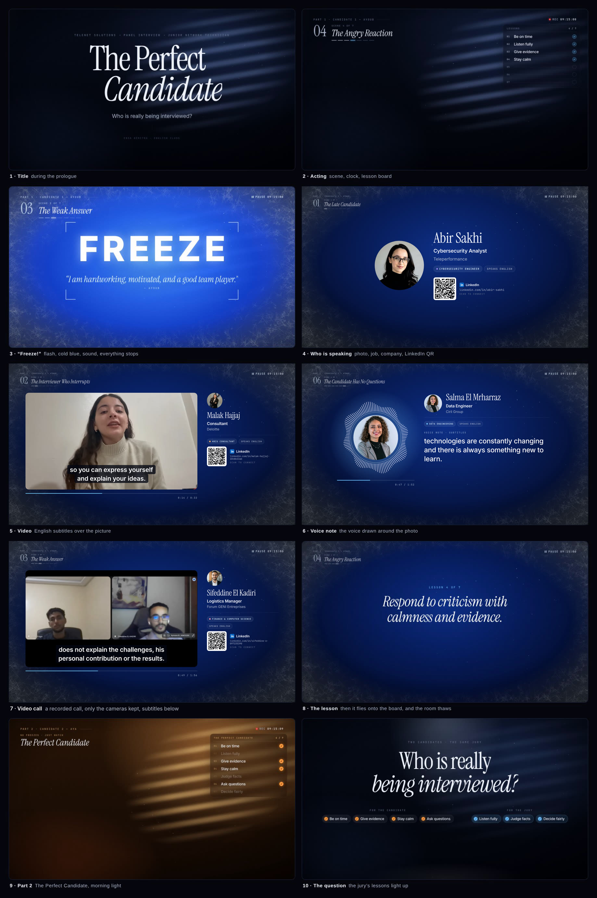

# The Perfect Candidate · stage screen

The screen behind the actors for *The Perfect Candidate* (ENSA Kénitra, English class). While you act, it is a calm
night-office backdrop that shows the scene. When the Narrator says **“Freeze!”**, the screen turns to ice with a sound,
a professional answers in a video or voice note with subtitles, the lesson goes on the board, and the room thaws.



The seven professionals, one per freeze (details in `app/content/experts.ts`):

| Scene | Professional | Clip |
|---|---|---|
| 1 · Being late | Abir Sakhi, Cybersecurity Analyst at Teleperformance | video, English |
| 2 · Interruptions | Malak Hajjaj, Consultant at Deloitte | video, English |
| 3 · Weak answers | Sifeddine El Kadiri, Logistics Manager at Forum GENI Entreprises | video call, English |
| 4 · Managing anger | Youssef Ennaciri, Head of Information Systems at Hôpital Universitaire International Cheikh Zaid | voice note, French |
| 5 · First impressions | Taha Jaid, SOC Manager at AMANDIGITAL | video, French |
| 6 · Asking questions | Salma El Mrharraz, Data Engineer at Ciril Group | voice note, English |
| 7 · Quick decisions | Youssef Med, Aeronautical Engineer (workplace kept private) | voice note, French |

To change or replace a clip, see [Adding a real clip](#adding-a-real-clip). Every subtitle, with what is said
and its time, is listed in [SUBTITLES.md](SUBTITLES.md) for checking while watching.

## Online (Vercel)

The show is also hosted on Vercel, built from this repository: every push to `main` updates the website by itself.
Open the site, click once on the page, then press → to start. For the play itself, present from the offline folder
below (no internet needed, and full screen always works).

Settings live in `vercel.json` (install with pnpm, build `app/`, publish `app/dist`). Nothing to configure on Vercel.

## Run the show

1. Open **`presentation/index.html`** in **Google Chrome** (double click; no internet, no install, no server).
2. Press **F** for full screen. Put the window on the projector.
3. Before the audience comes in, press once: you hear a soft whoosh (sound check) and the title appears.
4. Give the Narrator the clicker and **[PRESS-SHEET.pdf](PRESS-SHEET.pdf)** for the clipboard.

Keep the folder together: `index.html` needs the `media/` folder next to it. Copy the whole `presentation/` folder to
the USB key and the second device.

### The 20 clicks (all on the Narrator's own words)

The Narrator uses a Bluetooth mouse: **left click = forward, right click = back**. The pointer hides by itself.

| # | The Narrator… | The screen |
|---|---|---|
| 1 | clicks once before the audience comes in | sound check, then the title (stays during the prologue) |
| 2 | ends the prologue: “…not the one on the chair.” | “Candidate 1 — Ayoub”, then Scene 1 in the corner, clock at 9:15 |
| 3, 5 … 15 | says **“Freeze!”** (scenes 1–7) | flash, cold blue, freeze sound, everything stops |
| 4, 6 … 16 | says the last words before the video (“Here is the right way to arrive.”) | **the question** of the scene (7 s, then it moves on by itself; a click moves on sooner) → who is speaking → clip with subtitles → the lesson → it flies onto the board → **unfreeze sound, the room thaws by itself** |
| 17 | “Same jury. Same chaos. Now, a new candidate: Aya.” | **The Perfect Candidate**: morning light, Aya's four lessons checked |
| 18 | “…not the only ones being interviewed.” | “Who is really being interviewed?”, the jury's three lessons light up |
| 19 | after the bow | **Keep practising**: 3 accounts to follow and 3 websites, each with a QR code to scan |
| 20 | once people have scanned | credits |

The unfreeze sound is the actors' cue: lower the hand when it starts, act again when it fades. The scene name in the
corner moves to the next scene by itself after the last lines of each scene.

### Keys

| Key | What it does |
|---|---|
| **left click** · → Space Enter PageDown | next |
| → (keyboard right arrow) | next **even while a clip plays**: stops the clip and moves to the next screen (for whoever runs the laptop) |
| **right click** · ← Backspace PageUp | **undo** the last click. Back during a clip stops it; back after a too-early “Freeze!” brings the room back |
| S | skip the clip now (emergency) |
| B or . (clicker blank button) | black screen; any press brings the picture back |
| F | full screen |
| number, then Enter | jump to that screen (1 = pre-show) |
| H | help: where the show is, the next cue, the keys (for rehearsals, not during the show) |

Safety built in: presses are ignored while a clip plays (except the keyboard's → arrow); a double press within ¾ s counts once; a held key does not
repeat; F5 (sent by some clickers) does not reload; after a reload the show reopens where it was; a clip that cannot
play is skipped after a few seconds and the show goes on.

## Adding a real clip

You need [ffmpeg](https://ffmpeg.org/download.html) and Python 3 for step 1, and Node 22 with pnpm for step 4. Or send
the files and the person's details and it can be done for you.

1. **Convert and level it** (any phone video or voice note: .mp4, .mov, .ogg, .opus, .m4a…):

   ```bash
   python3 tools/media/prepare.py ~/Downloads/video-from-whatsapp.mp4 scene-1-hr-manager
   ```

   This writes the clip to `app/public/media/` (WebM + MP4 at 720p, about 5-10 MB a minute instead of 100+, phone rotation kept, same loudness as every
   other clip) with its poster picture and the voice waveform. Options: `--audio` keeps only the sound (a call
   recorded with the camera off becomes a voice note), `--crop W:H:X:Y` keeps part of the picture (the video tiles of
   a screen-recorded call), `--end 89.9` cuts the dead air after the last word.
2. **Subtitles**: write `app/subtitles/scene-1-hr-manager.vtt` (or let `tools/subtitles/align.py` time them for you
   from a line-by-line transcript: see the top of that file). If they speak English, write what they say; if they
   speak French, write the English translation. Two lines at most per subtitle:

   ```text
   WEBVTT

   00:00:00.500 --> 00:00:04.000
   When a candidate walks in late, the jury notices.

   00:00:04.100 --> 00:00:07.800
   Call before the interview if you will be late.
   ```

3. **The person**: in `app/content/experts.ts`, edit the entry of that scene: `file`, `kind` (video or audio),
   `orientation` (portrait for a phone held upright), `language`, and the person (name, job title, company, profile,
   photo file, LinkedIn). **Show only what they agreed to**: `name: null` shows the job title only, `company: null`
   hides the workplace, `photo: null` shows an icon, `linkedin: null` hides the LinkedIn line and the QR code.
4. **Rebuild** the folder you present from:

   ```bash
   pnpm install
   pnpm release
   ```

To rehearse with live changes instead: `pnpm dev` and open http://127.0.0.1:5190.

## Tuning for the room

- **Scene timing**: `tailSeconds` in `app/content/scenes.ts` is how long after the thaw the corner moves to the next
  scene. Film a rehearsal and set each one to the time the actors need for the lines left in that scene.
- **Text too low** (the jury table hides the bottom of the screen): everything important sits in the top two thirds.
  The final question's lesson row can be raised with `--lift` in `app/src/styles.css`.
- **Sound volume**: set the laptop volume during the sound check; clips are levelled to the same loudness as each
  other.
- **Questions**: the question shown after each freeze is `question` in `app/content/scenes.ts`; how long it stays
  before the professional starts is `QUESTION_HOLD` in `app/slides/question.ts` (7 s).
- **Resources**: the accounts and websites of the “Keep practising” screen are in `app/content/resources.ts`; each
  `url` becomes a QR code.
- **Lessons**: the words on the board are the script's “Lesson on screen” sentences; the short labels are `label` in
  `app/content/scenes.ts`.

## How it is made

Built on the motion-deck engine of [samouraifox/school-innovation-project](https://github.com/samouraifox/school-innovation-project)
(`packages/kit`: the 1920 × 1080 stage, one press per screen, transitions, reload resume, black screen, keyboard). Added
to the engine for this show: slide enter hooks (to start media and sounds), a press hold while a clip plays, a
double-press guard and a stage hook for layers that live across slides. Everything else is in `app/`:

| Where | What |
|---|---|
| `app/content/` | the script's scenes, questions and lessons, the seven professionals, the resources, the cast, the voice waveforms |
| `app/slides/` | the 28 screens: pre-show, title, Part 1, (freeze, question, professional) ×7, Part 2, final question, resources, credits |
| `app/src/world/` | the room (night, ice, morning light, dust, frost) and the HUD (scene, clock, lesson board) |
| `app/src/media/` | the clip player and the subtitles |
| `app/src/sound.ts` | the freeze and unfreeze sounds, made in code |
| `tools/media/` | prepares a real clip |
| `tools/examples/` | how the rehearsal stand-in clips were made before the real ones arrived (Piper voices, drawn placeholders) |
| `tools/press-sheet/` | makes PRESS-SHEET.pdf from the script |
| `presentation/` | the built show to present from |

Checks: `pnpm check` (types and the engine's unit tests).

Design decisions and why: [DECISIONS.md](DECISIONS.md).
